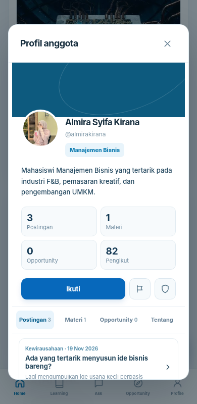
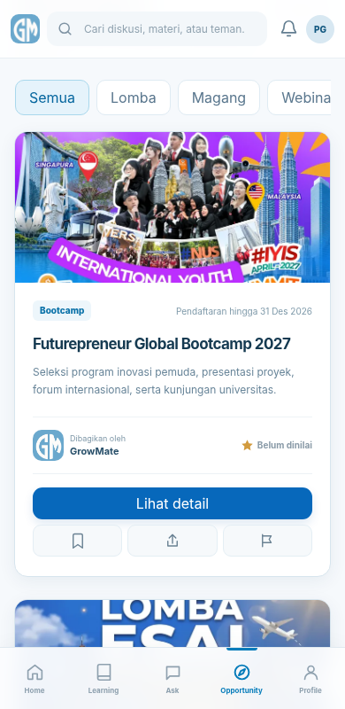

# GrowMate

**Ruang belajar dan komunitas mahasiswa**, dibangun sebagai aplikasi web MVP untuk mengeksplorasi diskusi, materi belajar, kesempatan pengembangan diri, dan ruang tanya kampus.

GrowMate menggunakan **HTML, CSS, JavaScript ES Modules, dan Node.js tanpa dependensi npm pihak ketiga**. Antarmuka dirancang responsif untuk HP dan desktop.

> **Status proyek:** prototipe interaktif (*local-first*), bukan layanan multipengguna produksi. Akun, postingan, pengaturan, laporan, ajakan, dan pesan uji disimpan di browser. Tidak ada database, server autentikasi, moderator aktif, atau sinkronisasi antarperangkat. Gunakan identitas dan data uji.

## Coba di VS Code

Persyaratan: **Node.js 20+** dan browser modern.

```bash
npm start
```

Buka **http://localhost:3000**, pilih **Daftar**, lalu buat akun uji. Tidak perlu `npm install`, API key, atau database. Jangan membuka `index.html` lewat `file://` karena modul JS perlu dijalankan melalui server.

Untuk menguji seluruh fitur secara otomatis:

```bash
npm test
```

Alternatif di Windows jika perintah `npm` dibatasi PowerShell: jalankan `node server.mjs` langsung.

## Fitur yang dapat dicoba

| Area | Tersedia di MVP |
| --- | --- |
| **Beranda** | Feed, posting, media, komentar, like, simpan, bagikan, laporkan |
| **Learning** | Katalog materi, bab, progres belajar, materi buatan pengguna, share dan report |
| **Opportunity** | Informasi dengan poster, pencarian/filter, simpan, share, laporkan, dan unggah info sendiri |
| **Ask Space** | Kontak mahasiswa/grup, contoh layanan kampus, pesan dan undangan lokal |
| **Profil** | Sampul, avatar, bio, arsip pribadi, profil publik anggota dengan statistik dan tab konten |
| **Pengaturan** | Bahasa, tema, akun lokal, serta riwayat like, komentar, laporan dan blokir |
| **Admin kampus** | Simulasi direktori, pengajuan chat, persetujuan, pengumuman, dan jadwal pada browser yang sama |

**Alur laporan:** pilih ikon bendera → alasan laporan → simpan → tentukan apakah konten ingin disembunyikan. Untuk laporan akun, pengguna dapat memilih memblokir akun. Pilihan menyembunyikan **tidak muncul sebagai tombol tersendiri pada kartu konten**. Konten yang disembunyikan dapat dipulihkan dari **Pengaturan → Riwayat aktivitas**. Laporan hanya tercatat secara lokal.

Jumlah **pengikut profil contoh adalah data ilustratif**, bukan pengguna aktif atau metrik server. Angkanya berubah +1 ketika kamu memilih *Ikuti* pada akun lokal yang dipakai untuk review.

**Dua kartu Opportunity tanpa poster** pada versi sebelumnya telah dihapus. Katalog masih menampilkan informasi berposter serta opportunity yang diunggah pengguna pada perangkat tersebut.

## Struktur proyek

```text
GrowMate/
├── index.html           # halaman utama dan kebijakan keamanan browser
├── server.mjs           # server development statis, hanya melayani UI/aset publik
├── package.json         # perintah start dan test
├── src/                 # fitur JavaScript dan stylesheet
├── assets/              # logo, poster, avatar, gambar, materi contoh
├── tests/               # pemeriksaan fitur otomatis (Node.js)
├── docs/                # dokumentasi dan panduan review juri
├── CONTRIBUTING.md
└── README.md
```

## Cuplikan antarmuka

| Profil publik (HP) | Opportunity (HP) |
| --- | --- |
|  |  |

Lihat juga [tampilan desktop](docs/screenshots/opportunity-desktop.png) dan [konfirmasi setelah laporan](docs/screenshots/konfirmasi-laporan.png). Screenshot diambil menggunakan data contoh, bukan akun pengguna sungguhan.

## Dokumentasi

- [Panduan demonstrasi untuk juri](docs/DEMO.md)
- [Daftar fitur dan batasan](docs/FEATURES.md)
- [Arsitektur dan penyimpanan](docs/ARCHITECTURE.md)
- [Pertimbangan UI/UX dan aksesibilitas](docs/DESIGN.md)
- [Keamanan dan privasi](docs/SECURITY.md)
- [Pengujian](docs/TESTING.md)
- [Panduan penggunaan](docs/USER-GUIDE.md)
- [Arah pengembangan](docs/ROADMAP.md)
- [Catatan aset](docs/ASSETS.md)
- [Gambaran proposal](docs/PROPOSAL.md)

